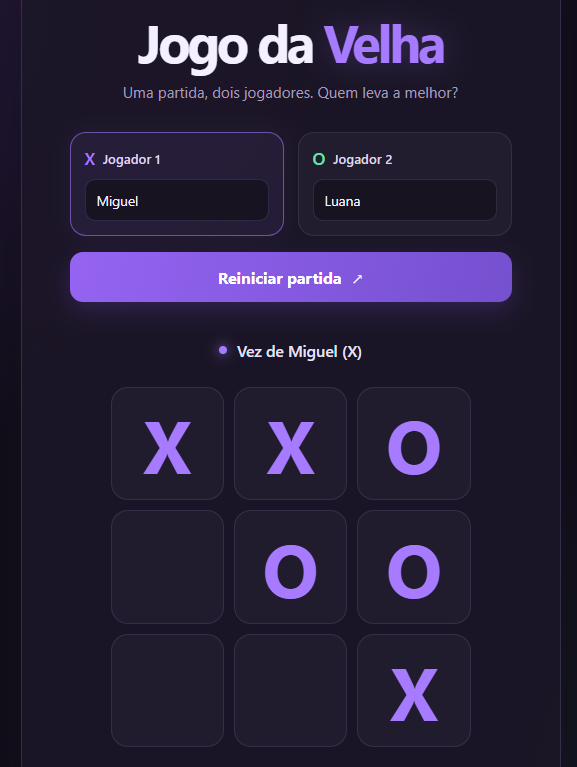

# Jogo da Velha

Um jogo da velha para duas pessoas, feito com HTML, CSS e JavaScript. A interface tem tema escuro, detalhes em roxo e verde, e se adapta a computadores e celulares.

## Funcionalidades

- Cadastro dos nomes dos dois jogadores.
- Alternância de turnos entre X e O.
- Identificação visual do jogador da vez.
- Detecção de vitória e destaque das casas da combinação vencedora.
- Detecção de empate.
- Bloqueio de novas jogadas após o fim da partida.
- Botão para começar ou reiniciar a partida.
- Casas do tabuleiro acessíveis por teclado, com rótulos para leitores de tela e foco visível.
- Layout responsivo, sem bibliotecas externas.

## Tecnologias

- HTML
- CSS
- JavaScript

## Como executar

1. Baixe ou clone este projeto.
2. Abra o arquivo `index.html` em um navegador atualizado.
3. Informe os nomes dos jogadores e clique em **Começar partida**.

Não é necessário instalar dependências ou iniciar um servidor local.

🔗 [Jogar online](https://renata-vitoria.github.io/jogo-da-velha/)

🔗 [Ver código no GitHub](https://github.com/Renata-Vitoria/jogo-da-velha)

## Demonstração

## Sobre o projeto

Este projeto começou como um exercício guiado de programação. Ao longo dos meus estudos, aprimorei a interface, a acessibilidade e o comportamento do jogo, mantendo sua proposta simples e sem dependências externas.
